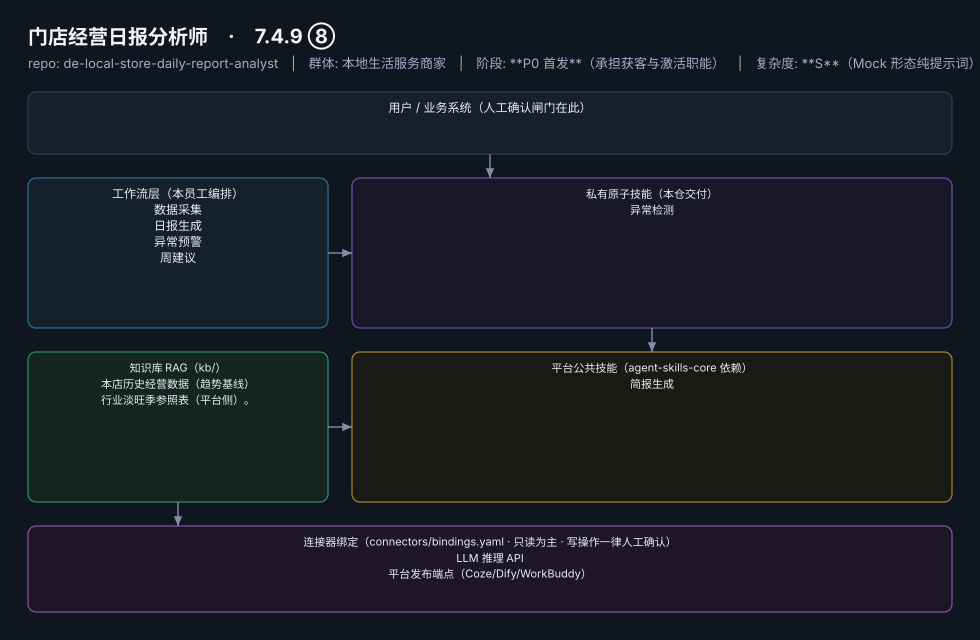

# 门店经营日报分析师

> 每天打烊后一句话告诉老板"今天生意怎么样、明天注意什么"
>
> **7.4.9 ⑧**　·　本地生活服务商家　·　阶段 **P0 首发**（承担获客与激活职能）　·　
> 复杂度 **S**（Mock 形态纯提示词）　·　**免费开放（钩子资产）**；付费版 50–150 元/月（自动数据对接版）；代配置服务加成：0–200 元/次（数据对接代办，故意压低以换取转化漏斗入口）　·　定义卡 7.4.9 ⑧

## 演示（真实执行录播）


*真实执行回放（GIF 自动循环，非摆拍）· [▶ 观看完整版 MP4](workflows/wf-local-daily-anomaly/docs/images/08-demo-run.mp4) · 台账见 [`reports/real-run/wf-local-daily-anomaly.md`](reports/real-run/wf-local-daily-anomaly.md)*



## 效果（真实执行）


*上图为**真实效果对比**，不是示意图：左栏是输入材料与要求，右栏是该次执行的产出原文，
两栏取自同一次真实执行记录。*

- 完整台账：[`reports/real-run/wf-local-daily-anomaly.md`](reports/real-run/wf-local-daily-anomaly.md)
- 录屏与终端回放：[`workflows/wf-local-daily-anomaly/docs/images/`](workflows/wf-local-daily-anomaly/docs/images/)（`08-demo-run.gif` / `08-demo-run.mp4` / `04-terminal-run.png`）
- 使用示例：[`workflows/wf-local-daily-anomaly/docs/使用示例.md`](workflows/wf-local-daily-anomaly/docs/使用示例.md)
> 实测判定：**通过**　·　可用度 4/5　·　编造数字 0 处　·　红线命中 4 次 / 拦截 4 次


**一句话**：全部门店（受众最广）

---

## 这个数字员工解决什么问题

云端定时+微信推送；**Mock 先行为核心形态**，不连任何系统也能交付价值。

| 项 | 内容 |
|---|---|
| 服务对象 | 全部门店（受众最广） |
| 可量化目标 | 日报推送准时率 100%（每晚 22:00）；老板阅读耗时 ≤1 分钟；异常预警召回率 |
| 投入产出 | 付费意愿弱但获客价值大：日报是老板每天唯一必看的推送，天然承载其他智能体的交叉销售入口 |
| 需求依据 | D06、D02、D27 |
| 分发渠道 | GitHub（必备，开源 Skill 引流主力）、**小红书/抖音**（"开店老板都在用的日报模板"内容钩子）、豆包工作、千问办公 |

## 30 秒上手

```bash
git clone <本仓库地址> && cd de-local-store-daily-report-analyst
pip install pyyaml
python3 tests/run.py            # 先跑一遍自检，确认环境与契约都对得上
```

试用（把 `<输入>` 换成本人真实材料）：

```text
请以「门店经营日报分析师」的身份，帮我跑「数据采集」。
材料如下：<输入>
要求：只使用材料里出现过的数字，缺的写 <待填>；对外文案停在待确认状态。
```

详细接入见 [`docs/01-安装与接入.md`](docs/01-安装与接入.md)。

## 仓库结构

```text
de-local-store-daily-report-analyst/
├── employee.md            # 人读定义卡（12 主字段 + 2 扩展组，由 employee.yaml 生成）
├── employee.yaml          # 机器契约（能力清单 + 依赖锁）
├── dependencies.yaml      # 对 core 的外部依赖（含版本）
├── persona/               # 运行提示词 / 边界 / KPI
├── skills/                # 私有原子技能（1 个）
├── spec-bindings/         # 有意不公共化能力的本地绑定声明（1 个）
├── workflows/             # 本员工工作流（4 条）
├── kb/                    # 知识库 RAG 契约
├── connectors/            # 连接器绑定（只读为主，写操作人工确认）
├── docs/                  # 六类发布文档
└── tests/                 # 自动化多场景测试
```

## 私有原子技能（1）

| 技能 | slug | 复杂度 | 阶段 | 成熟度 |
|---|---|---|---|---|
| `异常检测` | `anomaly-detect` | S | P0 | 已实现 |

## 平台公共技能依赖（1）

| 技能 | slug | 全平台复用员工数 |
|---|---|---|
| `简报生成` | `brief-generator` | 10 |

> 这些技能来自 `agent-skills-core@1.0.0`，本仓库**只引用不复制**。

## Spec 绑定层（1）

| 能力 | slug | 契约位置 | 本仓落点 |
|---|---|---|---|
| `数据对接` | `data-ingest-adapter` | `agent-skills-core/specs/data-ingest-adapter.md` | `spec-bindings/data-ingest-adapter.md` |

> 这一族能力**有意不公共化**（与外部平台接口强绑定）。本仓不存正文，
> 只留本地绑定声明与连接器配置。

## 工作流（4）

| 工作流 | slug | 触发 | 阶段 | 调用技能数 |
|---|---|---|---|---|
| `数据采集` | `wf-local-daily-collect` | 定时（每日 21:30） | P0 | 1 |
| `日报生成` | `wf-local-daily-report` | 定时（每日 22:00） | P0 | 1 |
| `异常预警` | `wf-local-daily-anomaly` | 事件（指标越界） | P0 | 1 |
| `周建议` | `wf-local-daily-weekly-advice` | 定时（每周一） | P1 | 2 |

## 知识库与连接器

- 知识库语料：['本店历史经营数据（趋势基线）', '行业淡旺季参照表（平台侧）。']
- 连接器：LLM 推理 API、平台发布端点（Coze/Dify/WorkBuddy）

## 质量与验收

| 项 | 值 |
|---|---|
| 技能文件数 | 100 |
| 多场景用例数 | 164 |
| 用例通过 | 164 |
| 验收结论 | ✅ 通过 |

完整报告：[`docs/05-验收与测试.md`](docs/05-验收与测试.md)

## 许可

专有许可，详见 [`LICENSE`](LICENSE)。
