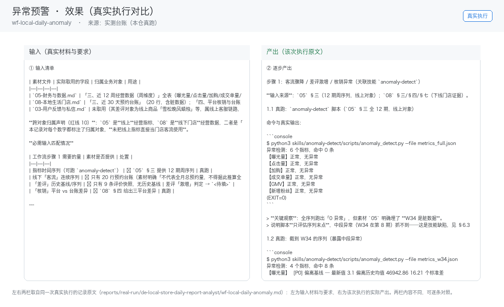

# 03 · 场景与价值

## 谁在用

全部门店（受众最广）

## 三个典型场景

### 场景 A：数据采集
- **触发**：定时（每日 21:30）
- **之前**：人工从头做一遍，每次口径不一、结果不可比
- **之后**：营收/客流/团购核销/差评数据归集
- **收益**：替代打烊算账 30 分钟/天

### 场景 B：日报生成
- **触发**：定时（每日 22:00）
- **之后**：数据 → 一句话结论+三个关键数+一个行动建议
- **收益**：月省 15 小时算账时间

### 场景 C：异常预警
- **触发**：事件（指标越界）
- **之后**：客流骤降/差评激增/核销异常 → 即时推送
- **收益**：早一天发现异常=少一天失血

## 价值构成

| 维度 | 说明 |
|---|---|
| 省时间 | 付费意愿弱但获客价值大：日报是老板每天唯一必看的推送，天然承载其他智能体的交叉销售入口 |
| 提一致性 | 同一能力固化成技能，口径不再因人而异 |
| 降风险 | 业务红线写死在提示词里，越界即停 |
| 可审计 | 每个数字可回指输入，产出可追溯 |

## 与人工的边界

本员工**不替代决策**。它负责把重复劳动做成清单与初稿，
把决策点（要不要发、要不要改价、要不要道歉）留给人。

## 效果证据（真实执行）

**左输入 / 右产出**的对比图，取自一次真实执行（不是示意图、不是环境探测截图）：

| 证据 | 位置 |
|---|---|
| 完整台账（输入清单 + 逐步产出 + 质检 + 如实说明） | [`../reports/real-run/wf-local-daily-anomaly.md`](../reports/real-run/wf-local-daily-anomaly.md) |
| 效果对比图 | [`../workflows/wf-local-daily-anomaly/docs/images/00-effect.png`](../workflows/wf-local-daily-anomaly/docs/images/00-effect.png) |
| 终端回放 | [`../workflows/wf-local-daily-anomaly/docs/images/04-terminal-run.png`](../workflows/wf-local-daily-anomaly/docs/images/04-terminal-run.png) |
| 录屏（真实执行回放） | [`../workflows/wf-local-daily-anomaly/docs/images/08-demo-run.gif`](../workflows/wf-local-daily-anomaly/docs/images/08-demo-run.gif)　·　[`../workflows/wf-local-daily-anomaly/docs/images/08-demo-run.mp4`](../workflows/wf-local-daily-anomaly/docs/images/08-demo-run.mp4) |
| 使用示例（真实输入→输出） | [`../workflows/wf-local-daily-anomaly/docs/使用示例.md`](../workflows/wf-local-daily-anomaly/docs/使用示例.md) |

### 该次实测的判定

| 项 | 值 |
|---|---|
| 实测判定 | 通过 |
| 可用度 | 4/5 |
| 编造数字 | 0 处 |
| 红线命中 / 拦截 | 4 / 4 |
| 必需输入缺失已标注 | 5 处 |

> 该次执行用的是**模拟材料**（虚拟企业「拾光手作」）。换成你自己的材料需要重跑一遍——
> 数值纪律要求输出里每个数字都能在输入里找到出处，换材料后出处会变。
