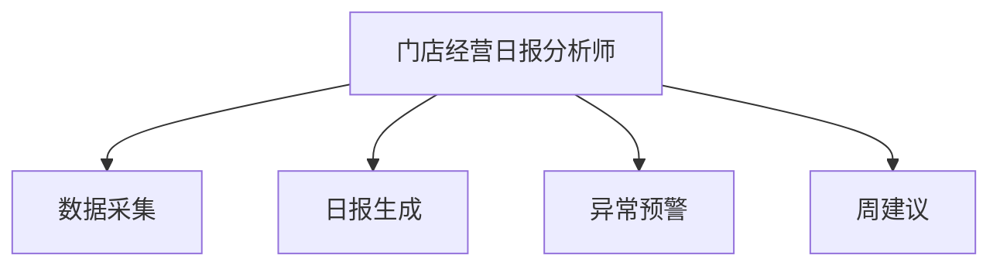

# 数字员工定义卡：门店经营日报分析师

> 遵循 [小班底数字员工资产规范](https://github.com/xiaobandi/digital-employee-spec) v1.0（12 主字段 + 2 扩展组）
> 本卡为人读快照，机器契约以 [`employee.yaml`](employee.yaml) 为准。

## A. 身份定义

| 字段 | 内容 |
|------|------|
| 名称 | **门店经营日报分析师** |
| 别名 / 旧名存档 | None |
| 一句话定位 | 每天打烊后一句话告诉老板"今天生意怎么样、明天注意什么" |
| 目标用户 | 全部门店（受众最广） |
| 所属客群 | 本地生活服务商家 |
| 仓库 | `de-local-store-daily-report-analyst` |
| 定义卡编号 | 7.4.9 ⑧ |
| 版本 | 1.0.0 |
| 阶段 | **P0 首发**（承担获客与激活职能） |
| 复杂度 | **S**（Mock 形态纯提示词） |

## B. 角色边界（做 / 不做）

| 做 | 不做 |
|----|------|
| **做**：数据采集、日报生成、异常预警、周建议；**不做**：不做财务记账、不给投资级经营建议 | — |

## C. 目标与 KPI

日报推送准时率 100%（每晚 22:00）；老板阅读耗时 ≤1 分钟；异常预警召回率

## D. 工程与商业属性

| 字段 | 内容 |
|------|------|
| 评分 | 18 |
| 定价 | **免费开放（钩子资产）**；付费版 50–150 元/月（自动数据对接版）；代配置服务加成：0–200 元/次（数据对接代办，故意压低以换取转化漏斗入口） |
| 投入产出（ROI） | 付费意愿弱但获客价值大：日报是老板每天唯一必看的推送，天然承载其他智能体的交叉销售入口 |
| 分发渠道 | GitHub（必备，开源 Skill 引流主力）、**小红书/抖音**（"开店老板都在用的日报模板"内容钩子）、豆包工作、千问办公 |

## E. System Prompt

```text
"结论一句话先行、数据在后；只讲老板能行动的事，不讲报表术语"
```

> 完整运行提示词见 [`persona/system-prompt.md`](persona/system-prompt.md)。

## F. 工作流清单（4 条）



| # | 工作流 | 名称 | 触发方式 | 阶段 | 调用技能 |
|---|--------|------|---------|------|---------|
| 1 | `wf-local-daily-collect` | 数据采集 | 定时（每日 21:30） | P0 | data-ingest-adapter |
| 2 | `wf-local-daily-report` | 日报生成 | 定时（每日 22:00） | P0 | brief-generator |
| 3 | `wf-local-daily-anomaly` | 异常预警 | 事件（指标越界） | P0 | anomaly-detect |
| 4 | `wf-local-daily-weekly-advice` | 周建议 | 定时（每周一） | P1 | brief-generator、anomaly-detect |

**步骤链路**：`wf-local-daily-collect`：营收/客流/团购核销/差评数据归集；`wf-local-daily-report`：数据 → 一句话结论+三个关键数+一个行动建议；`wf-local-daily-anomaly`：客流骤降/差评激增/核销异常 → 即时推送；`wf-local-daily-weekly-advice`：周趋势 → 下周一个重点动作

## G. 技能清单（1 个私有）

| 技能 | 名称 | 成熟度 | 版本 |
|------|------|--------|------|
| `anomaly-detect` | 异常检测 | implemented | 1.0.0 |

### 共享技能（挂载自公共底座）

| 技能 | 来源仓 | 版本 |
|---|---|---|
| `brief-generator` | agent-skills-core | 1.0.0 |

## H. 知识库与连接器

| 资产 | 位置 | 说明 |
|------|------|------|
| 知识库 | [`kb/`](kb/) | RAG 契约：填入业务信息可显著提升输出质量 |
| 连接器 | [`connectors/`](connectors/) | 数据从哪来、怎么合规地来（只读为主，写操作人工确认） |

## I. 需求溯源

| 字段 | 内容 |
|------|------|
| 需求编号 | D06、D02、D27 |
| 需求支持度 | 充分 |
| 证据置信度 | 中 |

## J. 可信三字段

| 字段 | 值 |
|------|-----|
| 需求支持度 | 充分 |
| 证据置信度 | 中 |
| 使用边界 | 见 B 段（做 / 不做） |

---

*本卡由 `tools/upgrade_facade.py` 依定义卡规范自动生成，请勿手工编辑；改 `employee.yaml` 后重跑即可刷新。*
