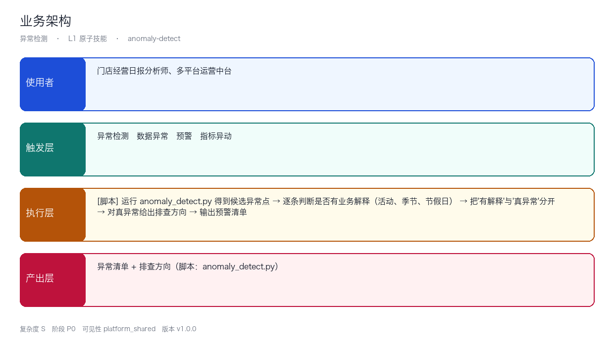
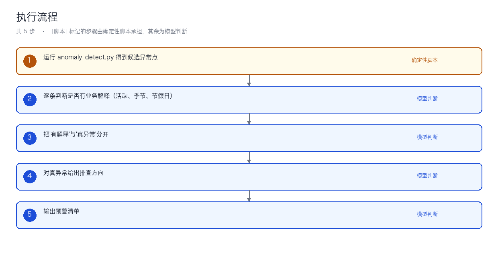
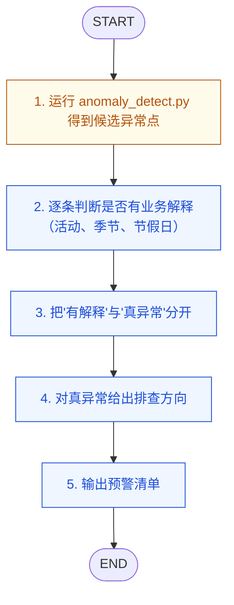
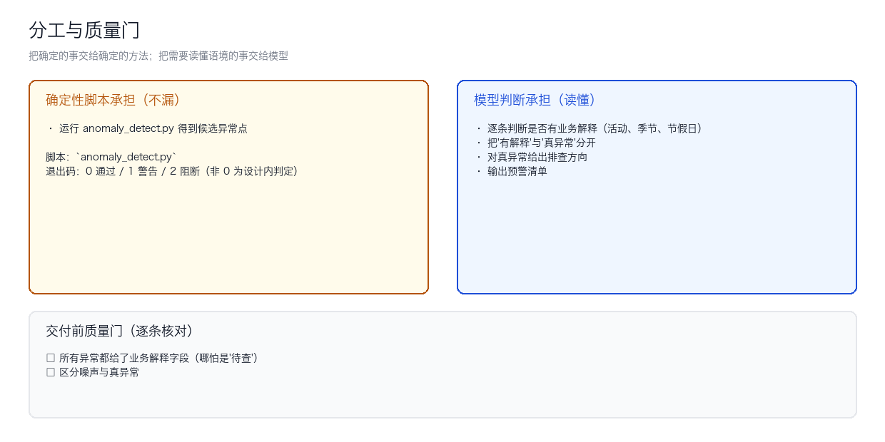

# 架构与流程图

包含架构图、流程图的 Mermaid 源码（方便你改），以及二次开发指南。

---

## 一、业务架构



| 层 | 内容 |
|----|------|
| 使用者 | 门店经营日报分析师、多平台运营中台 |
| 触发层 | 异常检测、数据异常、预警、指标异动 |
| 执行层 | 5 步：[脚本] 运行 anomaly_detect.py 得到候选异常点 … |
| 产出层 | 异常清单 + 排查方向 |

---

## 二、执行流程



### Mermaid 源码



### 步骤职责

| # | 步骤 | 承担者 |
|---|------|--------|
| 01 | 运行 anomaly_detect.py 得到候选异常点 | 确定性脚本 |
| 02 | 逐条判断是否有业务解释（活动、季节、节假日） | 模型判断 |
| 03 | 把'有解释'与'真异常'分开 | 模型判断 |
| 04 | 对真异常给出排查方向 | 模型判断 |
| 05 | 输出预警清单 | 模型判断 |

> 「承担者」的判据是**这个环节是不是确定性的**：机械、可复现的交脚本，需要读懂语境（语气、潜台词、平台调性）的交模型——写成规则只会更不可靠。
> 每一步的输入、产出与失败处理，见 `SKILL.md` 的「执行步骤」对应小节。

---

## 三、脚本与模型的分工



分工原则：**把确定的事交给确定的方法，把需要读懂语境的事交给模型**。

| 环节 | 承担者 | 为什么 |
|---|---|---|
| 机械处理（扫描、渲染、打标、计算） | 脚本 | 可复现、可测试、零成本、不怕漏 |
| 语境判断（反讽、潜台词、平台调性） | 模型 | 规则写法只会更不可靠 |
| 最终交付判定 | 人 | 合规与承诺不能由机器签字 |

---

## 四、输入输出契约

**输入**

| 字段 | 必填 | 说明 |
|---|---|---|
| 指标时间序列数据 | ✅ | — |
| 业务基线 | ⬜ | — |
| 已知的活动日历 | ⬜ | — |

**输出**

```markdown
| 指标 | 异常类型 | 等级 | 值 | 业务解释 | 排查方向 |
```

---

## 五、扩展指南

### 5.1 增加一个执行步骤

1. 在 `SKILL.md` 的 `## 执行步骤` 里追加一步，写明**输入、产出、失败怎么办**
2. 如果是机械环节，写成脚本放进 `scripts/`，并在步骤前加 `[脚本]` 标记
3. 同步更新本文件的 Mermaid 源码与 `README.md` 的输出契约
4. 在技能库根目录重新跑平台兼容校验：`python3 tests/run.py`（写成 `.` 只在 cwd 恰好是本技能目录时才成立，容易踩）

### 5.2 换掉/新增脚本

脚本约定三条（保持不变才能被安全替换）：

1. **零第三方依赖**，只用 Python 标准库
2. **文件/stdin 进，stdout 出**，不用交互式输入
3. **退出码语义**：0 通过 / 1 警告 / 2 阻断

### 5.3 移植到新平台

本技能正文里**没有出现任何平台名**，平台差异全部下沉到平台安装章节。移植时只改安装说明，不改执行步骤。
新增平台时请把差异写进 `docs/使用手册.md` 的「各平台差异」表，不要写进 SKILL.md。

---

## 六、文件职责一览

| 文件 | 职责 | 依赖模型 |
|------|------|----------|
| `SKILL.md` | 技能定义与执行步骤 | — |
| `scripts/check_env.py` | 环境探测与降级 | — |
| `scripts/anomaly_detect.py` | 确定性执行逻辑 | 否 |
| `docs/*` | 交付文档 | — |
| `examples/*` | 真实运行夹具与输出 | — |
