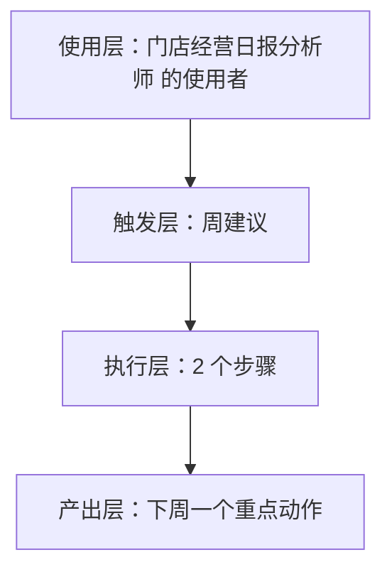
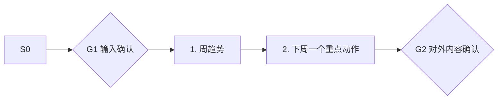

# 周建议 · 架构与流程图

## 本工作流的四层结构

| 层 | 内容 |
|---|---|
| 使用层 | 全部门店（受众最广）；员工定位：每天打烊后一句话告诉老板"今天生意怎么样、明天注意什么" |
| 触发层 | 关键词 / 显式点名「周建议」；触发方式：定时（每周一） |
| 执行层 | 周趋势 → 下周一个重点动作 |
| 产出层 | 下周一个重点动作 |

## 执行流程

## 步骤职责表

| # | 步骤 | 承担者 | 为什么 |
|---|---|---|---|
| 1 | 周趋势 | 模型 | 需要读懂语境，不可用固定规则替代 |
| 2 | 下周一个重点动作 | 模型 | 需要读懂语境，不可用固定规则替代 |

⚠️ 尚未补齐：图中的步骤来自注册表口径，未逐条实跑校验；实跑后请同步修订本页（`发布标准.md` 第六项：通读一遍，不得出现重复填充句）。
